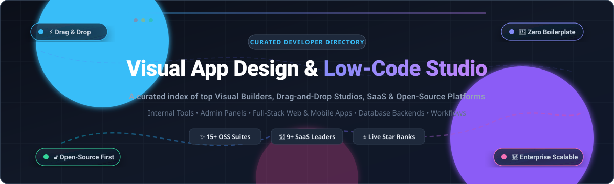

# Awesome Visual App Design & Low-Code Studio 🎨✨

  

  

> 🚀 A curated list of top Visual App Design, Drag-and-Drop Builders, and Low-Code / No-Code Studio platforms — both commercial SaaS enterprise solutions and open-source alternatives for building internal tools, web applications, customer portals, and admin panels.

---

## 📑 Table of Contents 🧭

- [📈 Sector Overview & Market Dynamics](#-sector-overview--market-dynamics-)
- [🟦 SaaS / Hosted Platforms](#-saas--hosted-platforms-)
- [🟩 Open-Source Platforms & Frameworks](#-open-source-platforms--frameworks-)
- [📊 Feature Comparison Matrix](#-feature-comparison-matrix-)
- [⭐ Star History](#-star-history)
- [💖 Support & Community](#-support--community)
- [🤝 Contributing](#-contributing-)
- [📄 License](#-license-)

---

## 📈 Sector Overview & Market Dynamics 🌐

The global Low-Code Application Platform (LCAP) and Visual Development market is valued at approximately **$31B to $36B in 2024–2025** and is projected to surpass **$50B to $65B by 2027–2028**, growing at a compound annual growth rate (CAGR) of **20%–28%**. 🚀

The sector exhibits a **moderately concentrated, bifurcated structure** ⚖️: enterprise leaders and hyperscalers (notably Microsoft Power Apps, OutSystems, Mendix / Siemens, and Appian) capture over 45%–50% of high-end enterprise workloads, while a vibrant, fast-growing long tail of specialized SaaS builders and self-hosted open-source frameworks (Appsmith, Directus, Refine, ToolJet, Budibase) continuously decentralize developer adoption for internal tools and rapid application delivery. 🛠️

---

## 🟦 SaaS / Hosted Platforms ☁️

Below is an overview of leading commercial Visual App Design and Low-Code Studio platforms, ranked in descending order by estimated company scale (valuation or parent revenue). 🏆

| Platform 🖥️ | Company Scale 🏢 (Valuation / Revenue) | Starting Paid Tier Pricing 💳 | Free Tier / Trial Limits 🎁 | Key Use Cases & Target Audience 🎯 |
| :--- | :--- | :--- | :--- | :--- |
| **[Microsoft Power Apps Studio](https://powerapps.microsoft.com/)** | **~$3.9T Market Cap** (Parent Microsoft; Power Platform ARR > $2B) | **$20/user/month** (Power Apps Premium; $12/user/month for 2,000+ seats); Pay-As-You-Go at $10/active user/app/month | **Developer Plan (Free forever):** 3 developer environments, 2 GB Dataverse database capacity, 750 Power Automate flow runs/month (strictly non-production prototyping). Also included with standard Microsoft 365 E3/E5 licenses for basic canvas apps without premium connectors. | Enterprise internal workflows, canvas & model-driven business apps deeply integrated with Microsoft 365, Teams, and Azure. |
| **[Webflow](https://webflow.com/)** | **$4.0B Valuation** (~$150M–$200M ARR) | **$14/month** billed annually ($18/month billed monthly) for Basic Site Plan | **Starter Plan (Free forever):** 2 static pages, 50 CMS database items, 1 GB bandwidth/month, 50 form submissions total; publishing restricted to `*.webflow.io` subdomain with Webflow badge. | Visual web design, production CMS websites, client portals, and responsive marketing applications. |
| **[Appian Studio](https://appian.com/)** | **$3.7B Market Cap** (NASDAQ: APPN; ~$795M TTM Revenue) | **~$75/user/month** (Standard Tier, annual contract minimums apply) | **Community Edition (Free forever):** Dedicated personal cloud workspace, core visual designer, single-instance database schema (capped for evaluation & training; non-production). | Regulated industries, complex BPM (Business Process Management), case management, and compliance workflows. |
| **[Retool](https://retool.com/)** | **$3.2B Valuation** (~$100M–$120M ARR) | **$10/user/month** billed annually ($12/user/month monthly) for standard builders ($5/user/month for end-users on Team plan) | **Free Plan (Free forever):** Up to 5 users total, unlimited web and mobile apps, 500 workflow runs/month, 5 GB Retool Database storage, 5 GB file storage, 20 hours/month AI agent runtime. | Developer-focused internal tools, database administration panels, executive dashboards, and operational CRUD apps. |
| **[OutSystems](https://www.outsystems.com/)** | **$2.5B–$4.0B Valuation** (~$350M–$500M ARR) | **~$36,300/year** (~$3,025/month entry-level production baseline) | **Personal Edition (Free forever):** 1 development environment/runtime on shared cloud, up to 100 internal users, 2 GB database storage, community support only; environment sleeps if inactive (non-production). | Large-scale mission-critical enterprise core systems, full-stack web and mobile apps with strict IT governance. |
| **[Bubble](https://bubble.io/)** | **~$1.0B–$2.0B Valuation** (~$70M–$80M ARR) | **$29/month** billed annually ($32/month monthly) for Starter Plan | **Free Plan (Free forever):** Up to 200 total database records (things), 500 MB storage, 1 editor seat, community support, core visual builder; no live custom domain (testing only on Bubble subdomain). | Full-stack web applications, startup MVPs, SaaS prototypes, and data-driven marketplace apps. |
| **[Mendix](https://www.mendix.com/)** | **~$800M–$1.0B Enterprise Value** (Siemens Unit; ~$200M–$265M ARR) | **$1,090/month** for Standard Single App ($2,725/month for Unlimited Apps) | **Free Edition (Free forever):** Mendix Studio Pro access, 1 free cloud deployment node (1 GiB RAM), up to 5 concurrent active users; app automatically sleeps after 1 hour of inactivity, no scheduled events. | Model-driven enterprise low-code, cross-department collaboration, IoT applications, and SAP/Siemens integrations. |
| **[FlutterFlow](https://flutterflow.io/)** | **~$170M Valuation** (~$25M–$35M ARR) | **$39/month** for Basic Plan ($30/month billed annually) | **Free Plan (Free forever):** Up to 2 active projects, 2 API endpoints, 5 lifetime AI generation requests, 20-minute test mode timeout, web preview on FlutterFlow subdomain with watermark; source code export disabled. | Native cross-platform iOS, Android, and web mobile app development with clean exportable Flutter code. |
| **[Glide](https://www.glideapps.com/)** | **~$50M–$100M Valuation** (~$5M–$10M ARR) | **$19/month** billed annually ($25/month monthly) for Explorer Plan; $49/month for Maker Plan | **Free Plan (Free forever):** 1 editor, 0 published live apps (sandbox testing only), up to 10 personal users, up to 25,000 Glide Table rows, community support. | Quick no-code internal apps, directories, and inventory managers built directly on top of spreadsheets and Airtable. |

---

## 🟩 Open-Source Platforms & Frameworks 🔓

Open-source, self-hostable low-code studios and visual app design frameworks that offer complete data ownership, local development capabilities, and zero vendor lock-in. Sorted by GitHub Stars_Count (descending). 🌟

- **[Strapi](https://strapi.io/)**  🌟  
  **Stack:** Node.js / TypeScript / React | **License:** MIT 📜  
  The leading open-source headless CMS and visual content-studio builder. Features a customizable admin panel, role-based access control, content schema designer, and instant RESTful and GraphQL API generation. Ideal for powering visual frontends and multi-channel applications. 🎯

- **[NocoDB](https://nocodb.com/)**  📊  
  **Stack:** Node.js / TypeScript / Vue.js | **License:** AGPL-3.0 📜  
  Transforms any existing relational database (PostgreSQL, MySQL, SQLite, SQL Server) into an interactive smart spreadsheet and visual database builder. Supports collaborative views (Grid, Gallery, Kanban, Form), REST APIs, webhooks, and automation formulas as an open-source Airtable alternative. ⚡

- **[Appsmith](https://www.appsmith.com/)**  🛠️  
  **Stack:** Java / TypeScript / React | **License:** Apache-2.0 📜  
  A prominent open-source low-code platform for building admin panels, CRUD apps, and internal tools with a drag-and-drop interface and 45+ pre-built widgets. Connects to 20+ databases (PostgreSQL, MySQL, MongoDB) and any REST or GraphQL API, featuring JS scripting and Git-based version control. 🚀

- **[ToolJet](https://tooljet.com/)**  ⚡  
  **Stack:** TypeScript / Node.js / React | **License:** GPL-3.0 📜  
  An enterprise-grade open-source low-code framework positioned as an alternative to Retool. Features an intuitive visual app builder, built-in database (ToolJet DB), workflow automations, granular access controls, and one-click Docker/Kubernetes self-hosting. 🐳

- **[Directus](https://directus.io/)**  📦  
  **Stack:** TypeScript / Node.js / Vue.js | **License:** BSL-1.1 / GPL-3.0 📜  
  An open-data platform that connects dynamically to any SQL database and instantly layers a visual data-studio UI, real-time GraphQL/REST APIs, granular user permissions, and custom event flows on top of existing schemas without migration overhead. 🔮

- **[Refine](https://refine.dev/)**  ⚛️  
  **Stack:** TypeScript / React / Next.js | **License:** MIT 📜  
  A React-based open-source framework for rapid development of data-heavy web applications, internal tools, admin panels, and B2B dashboards. Eliminates repetitive CRUD boilerplate while offering complete control over UI styling (Tailwind, Ant Design, Material UI, Mantine). 🎨

- **[Budibase](https://budibase.com/)**  🏗️  
  **Stack:** TypeScript / Node.js / Svelte | **License:** GPL-3.0 📜  
  An all-in-one low-code platform for building forms, internal applications, and portals. Includes an integrated database, external connectors (PostgreSQL, MySQL, Rest APIs, Google Sheets), visual logic design, automated cron tasks, and streamlined self-hosting. 💼

- **[NocoBase](https://www.nocobase.com/)**  🧩  
  **Stack:** TypeScript / Node.js / React | **License:** AGPL-3.0 📜  
  A scalability-oriented, private-first, plugin-driven open-source no-code and low-code development platform. Designed around data models, it enables non-technical creators and developers to visually build bespoke collaboration systems, CRM platforms, and operations management tools. 🏢

- **[Windmill](https://www.windmill.dev/)**  💨  
  **Stack:** Rust / Svelte / PostgreSQL | **License:** AGPL-3.0 📜  
  A code-first developer platform turning Python, TypeScript, Go, Bash, and SQL scripts into visual workflows, webhooks, and autogenerated UIs. Highly scalable execution engine designed as a modern open-source alternative to Retool and Airflow. ⚙️

- **[Amplication](https://amplication.com/)**  🧱  
  **Stack:** TypeScript / Node.js / NestJS | **License:** Apache-2.0 📜  
  An open-source developer tool that visually models data entities and roles to automatically generate production-ready NestJS backends, Prisma ORM schemas, REST/GraphQL APIs, and authentication boilerplate with Git sync. 🛠️

- **[ILLA Cloud](https://www.illasoft.com/)**  🤖  
  **Stack:** Go / TypeScript / React | **License:** Apache-2.0 📜  
  A low-code developer tool with rich drag-and-drop components, multi-data-source connectors, and native integration with AI agents and LLM APIs to build custom internal tooling and enterprise web dashboards. 🧠

- **[Baserow](https://baserow.io/)**  📋  
  **Stack:** Python / Django / Vue.js | **License:** MIT 📜  
  An open-source no-code database and Airtable alternative. Provides an accessible visual database studio with real-time collaboration, webhooks, flexible forms, and an application builder module to create custom frontends on top of relational records. 📈

- **[OpenBlocks](https://www.openblocks.dev/)**  🧱  
  **Stack:** TypeScript / React | **License:** AGPL-3.0 📜  
  An open-source low-code internal tool suite offering 50+ pre-designed UI components, JavaScript evaluation, support for popular SQL/NoSQL databases, and role-based permissions. 💻

- **[Lowcoder](https://lowcoder.cloud/)**  🖥️  
  **Stack:** Java / Node.js / React / MongoDB | **License:** AGPL-3.0 📜  
  A self-hostable open-source Retool alternative for building internal applications, dashboards, and client-facing interfaces with a drag-and-drop studio, JavaScript scripting, and custom component embedding. 🗄️

- **[Joget DX](https://www.joget.com/)**  🔄  
  **Stack:** Java | **License:** GPL-3.0 📜  
  An open-source application platform combining business process automation (BPM), workflow management, and rapid app development with visual form and datalist designers. 📋

- **[Convertigo](https://www.convertigo.com/)**  🛡️  
  **Stack:** Java / Angular | **License:** AGPL-3.0 📜  
  An AI-assisted full-stack enterprise low-code and no-code suite offering visual studios for business users and developers, legacy backend connectors (IBM 3270/AS400), offline sync, and sovereign hosting. 🌐

---

## 📊 Feature Comparison Matrix 🔍

| Platform 🛠️ | License / Type 📄 | Self-Hostable 🏠 | Primary Focus 🎯 | Best For 💡 |
| :--- | :--- | :---: | :--- | :--- |
| **Microsoft Power Apps** | Proprietary SaaS | ❌ | Enterprise Office/Azure workflows | Existing Microsoft 365 enterprise organizations |
| **Webflow** | Proprietary SaaS | ❌ | Visual design & CMS websites | Marketing websites and design-led customer portals |
| **Appian Studio** | Proprietary SaaS | ❌ | Low-code automation & BPM | High-compliance & regulated enterprise automation |
| **Retool** | Proprietary SaaS / Enterprise | ❌ (Hybrid) | Developer internal tools | Engineering teams building admin panels & dashboards |
| **OutSystems** | Proprietary SaaS / Enterprise | ❌ | Full-lifecycle enterprise app development | Large enterprises needing deep governance & SLAs |
| **Bubble** | Proprietary SaaS | ❌ | Full-stack web application builder | Startup MVPs, non-technical founders, and SaaS apps |
| **Mendix** | Proprietary SaaS | ❌ | Model-driven enterprise low-code | Industrial, SAP, and complex cross-department apps |
| **FlutterFlow** | Proprietary SaaS | ❌ | Cross-platform visual mobile app studio | Fast mobile MVP development with exportable Flutter code |
| **Glide** | Proprietary SaaS | ❌ | Spreadsheet-to-app builder | Rapid internal tools built from Google Sheets or Airtable |
| **Strapi** | Open Source (MIT) | ✅ | Headless visual content studio | Content-driven visual apps and API backends |
| **NocoDB** | Open Source (AGPL-3.0) | ✅ | Smart spreadsheet on SQL | Visual database & Airtable replacement |
| **Appsmith** | Open Source (Apache-2.0) | ✅ | Drag-and-drop internal tools | Teams seeking a mature open-source Retool alternative |
| **ToolJet** | Open Source (GPL-3.0) | ✅ | Low-code framework | Extensible self-hosted internal operations apps |
| **Directus** | Open Source (BSL / GPL-3.0) | ✅ | SQL data studio & backend suite | Zero-overhead visual database studio & APIs |
| **Refine** | Open Source (MIT) | ✅ | React-based CRUD dashboard builder | Frontend engineers seeking full code flexibility |
| **Budibase** | Open Source (GPL-3.0) | ✅ | Internal business applications & forms | Rapid internal tool prototyping with built-in DB |
| **NocoBase** | Open Source (AGPL-3.0) | ✅ | Plugin-driven no-code architecture | Scalable bespoke management systems and CRMs |
| **Windmill** | Open Source (AGPL-3.0) | ✅ | Code-first script-to-UI engine | High-throughput background flows and script automation |
| **Amplication** | Open Source (Apache-2.0) | ✅ | Visual backend & API generator | Automated NestJS/Prisma backend code generation |
| **ILLA Cloud** | Open Source (Apache-2.0) | ✅ | Low-code + AI agent builder | AI-integrated internal dashboards and tooling |
| **Baserow** | Open Source (MIT) | ✅ | No-code collaborative database | Self-hosted Airtable alternative with app builder |
| **OpenBlocks** | Open Source (AGPL-3.0) | ✅ | Developer-friendly low-code UI builder | Lightweight internal tools and SQL query visualization |
| **Lowcoder** | Open Source (AGPL-3.0) | ✅ | Self-hosted Retool alternative | JS-friendly admin panels and dashboards |
| **Joget DX** | Open Source (GPL-3.0) | ✅ | Low-code BPM & workflow management | Process-heavy legacy modernization |
| **Convertigo** | Open Source (AGPL-3.0) | ✅ | Sovereign enterprise low-code | Legacy system integrations and offline-first apps |

---

## 📈 Star History

---

## 💖 Support & Community 🙏

Thank you for visiting and using this curated directory! If you found this list valuable:
- ⭐ **Star** this repository to help other developers discover it!
- 🍴 **Fork** it and build your own visual development stack!
- 📢 **Share** it with your engineering team, developer community, or social network!
- ☕ **Buy me a coffee / Sponsor:** If you would like to support ongoing curation and open-source maintenance, consider sponsoring via the [GitHub Sponsor Dashboard](https://github.com/sponsors/ishandutta2007). Every bit of support is deeply appreciated! 💖

---

## 🤝 Contributing 💡

Contributions are welcome! If you know of an open-source visual app builder or low-code studio platform that should be included:

1. Fork this repository. 🍴
2. Add the tool to the appropriate section with its name, GitHub Stars_Badge, technology stack, license, and concise description. ✍️
3. Submit a pull request with a brief explanation of why the tool is a good fit. 🚀

Please ensure the project is actively maintained (recent releases) and provides clear installation / documentation resources.

---

## 📄 License ⚖️

This repository and curated list are released under the [CC0 1.0 Universal](LICENSE) (Public Domain Dedication).
